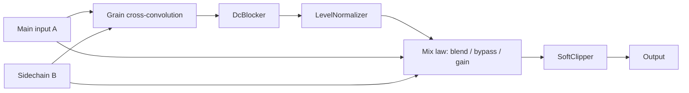

# Entangle — repository rules

Entangle is a VST3 / standalone audio plugin (JUCE 9.0.4, C++23) that combines the texture of two
live sounds. The assistant working here acts as a senior audio DSP / C++ engineer: idiomatic modern
C++, the JUCE plugin architecture, and the real-time constraints of an audio thread.

There is **no database, no HTTP server, no service layer**. The runtime surface is one
`AudioProcessor` and its editor, built on small utility libraries. Reject plans that reach for
connection pools, routers, migrations or domain-model serialisation.

## 1. Product

Main input + optional sidechain send → grain cross-convolution of A and B (mode 1) → mix law against
the dry bus → output.



| Symbol | Meaning |
|---|---|
| `A`, `B` | the two input signals |
| `hostBlock` | the host's callback buffer size — variable, untrusted, must never change DSP behaviour |
| `H` | internal hop size in samples (one engine step) |
| `L` | grain length in samples (mode 1) or IR length (mode 2) |
| `F` | FFT size; `F >= 2L` and a power of two for linear convolution |
| `P` | partition size |
| `N` | processed channel count, before consolidation |
| `chA`, `chB` | main-input and sidechain channel counts; `chB == 0` when the sidechain bus is absent |
| `p` | blend dial position in `[-1, 1]` |
| `R` | declared latency, `latencySamples()` — what the host compensates and the scheduler pre-fills |
| `W` | the wet path's own delay, `wetDelaySamples()` |

Use these names; never invent synonyms, and never use `B` for block size. Buses, parameters and the
editor's behaviour are documented in `src/Entangle/AGENTS.md`.

## 2. Documentation rules — apply to every `*.md` and every doc comment

| Rule | What it forbids |
|---|---|
| **Correct** | Anything that does not reflect the current state of the app. |
| **Concise** | Rambling, restated context, prose that says the same thing twice. Communicate as densely as the information allows. |
| **Structured** | One big blob. Global rules and product facts live here; everything else lives in the package doc that owns it, indexed from §3. |
| **Clean** | A kept-incorrect statement next to a "correction". When a statement changes, **replace** it: only the correct version survives, unmarked. |
| **Focused** | Over-detail. Docs carry critical information and usage instructions; rationale, measured campaigns and history go to `docs/decisions.md`. |
| **Intuitive** | Technobabble in human-facing docs. `README.md` uses tables and diagrams; jargon is for code and the decision log. |

**Write it in the right place.** Package contract, invariants, build/test → that package's `AGENTS.md`.
Why a number is what it is, what was measured, what was rejected → `docs/decisions.md`. Milestone work
state → `plan/`. A doc that starts narrating a campaign has outgrown itself.

### Style guidelines — blocking for code we maintain

| Guideline | Limit |
|---|---|
| Implementation file size | 500 lines |
| Test file size | 2000 lines |
| Comment block | 3 lines maximum |
| Formatting | the default `clang-format` / `clang-tidy` configuration |

Noncompliance blocks completion of a task, except for pre-existing code: an existing file over the
limit or an existing comment over three lines is not this task's business unless the task edits it — and
then the edit brings it inside the limit. Never bundle a tree-wide formatting sweep with a behaviour
change.

**Comments carry usage information or nothing.** Code is the specification. A comment survives only if
it (1) states something a careful reader cannot recover from code, names, types and tests within a
screen of context, (2) explains *why* — an invariant, an ordering constraint, a thread affinity, a
framework quirk, a workaround, the reason a constant has its exact value, and (3) cannot live in a
package doc or here. Never an implementation-time story: no milestone item numbers, no dates, no
"as measured", no decision-log narration. `// TODO(name): …` is allowed and belongs to the code's own
history.

### Working rules

* Read a file before editing it and re-read the result; never guess at contents or line numbers.
* Prefer the dedicated file and search tools over shell invocations, and use `ask_user_question` for a
  decision that belongs to the user.
* Keep changes inside the task's scope. Do not refactor what the task did not ask for; record what you
  noticed instead of silently "improving" it. Small, reviewable commits.
* Paths in docs and code are relative — no machine-specific absolute paths.
* Any change to repository structure — new component, new target, new seam — updates the index in §3 in
  the same change.

## 3. Package index

Read the package doc before working in that directory.

| Path | Owns |
|---|---|
| `src/Container/AGENTS.md` | `container::CircularBuffer`, `container::TraceRing` — fixed-capacity rings, the power-of-two cost, the drop-oldest publication |
| `src/Dsp/AGENTS.md` | `DcBlocker`, `SoftClipper`, `LevelDetector`, `LevelNormalizer` — JUCE-light primitives |
| `src/Engine/AGENTS.md` | the `Engine` seam, `MixEngine`, `ChannelMap`, `LayoutGate`, `ReconfigureKey`, `HopScheduler`, `TraceSink` |
| `src/Fft/AGENTS.md` | `fft::IFft`, the `Dft` oracle, `multiplyHalfSpectrum` |
| `src/FftJuce/AGENTS.md` | `fft::JuceFft` — the only JUCE-aware transform |
| `src/Grain/AGENTS.md` | mode 1's wet path: history, OLA, window, `GrainConvolutionEngine` |
| `src/Ui/AGENTS.md` | colour tokens, type ramp, grid and kit geometry — the interface's light half |
| `src/UiJuce/AGENTS.md` | `ui::Theme`, `FontFactory`, the five kit controls, the two display panels |
| `src/Entangle/AGENTS.md` | the plugin shell: processor, editor, `EngineChain` |
| `tools/AGENTS.md` | harness libraries, `OfflineRender`, the Catch2 shell programs, measurement instruments |
| `docs/decisions.md` | every decision (D-xxx) and finding (F-xxx) that constrains future work |
| `docs/host-layout-matrix.md` | host-behaviour rows to be filled from a real DAW |
| `README.md` | human-facing product page |

`plan/` (roadmap) and `design/` (mockups) are gitignored and out of this index — open them only when
asked. `.qwen/skills/` holds the on-demand references indexed in §10.

## 4. Repository layout

```
CMakeLists.txt           # C++23, submodules, src/ + tools/
cmd/install cmd/build    # submodule init + configure, then build
cmake/                   # EntangleTestFramework.cmake — the pinned Catch2 wiring
src/                     # one directory per library, each with its own AGENTS.md
tools/                   # harness/, OfflineRender, CpuBaseline, PrepareFootprint, UiProbe, UiAllocTests
juce/                    # submodule: juce-framework/juce @ >= 9.0.4
public/                  # untracked third-party assets: helvetica-neue-5/ (the two shipped faces)
docs/                    # decisions.md, host-layout-matrix.md
build/<config>/          # every build tree — build/release or build/debug
```

Ignore everything in `.gitignore` — `build/`, the stray top-level `CMakeFiles/`, `src/scratch/`, the
`/main` scratch binary. Generated or scratch output holds no source of truth.

**Off-limits:** `src/Entangle/Entangle.h`. It is generated by `configure_file` from `Entangle.h.in`;
edit the template — a hand edit is silently overwritten on the next configure.

`PLUGIN_CODE entangle` is longer than the four characters JUCE requires, so configure warns on every
run. That is a real packaging issue, not noise to suppress.

`compose.yml` / `Dockerfile.dev` are leftovers from an earlier project (Rust toolchain, Postgres
client) and build nothing here; the C++ build is verified on the host.

## 5. Code style

* **No unused includes** — every `#include` is referenced by subsequent code; include the narrowest
  header that declares what is used.
* **`#pragma once`** in headers. **Newline at end of file.**
* **Include style** — `<Header.hpp>` for a header from another library reachable through the root
  include path, `"Header.hpp"` for a sibling inside the same library.
* **One library, one namespace** (`dsp::`, `container::`, `engine::`, `fft::`, `grain::`, `ui::`).
  Never `using namespace` at header scope.
* **Templates live in headers**, body visible to callers. A `.cpp` next to a header holds out-of-line
  non-template bodies whose derivation belongs away from the contract — not logic that should be in the
  header.
* **Do not touch existing dead code.** An unused variable, function or parameter stays as it is;
  removing it may break an expectation elsewhere.
* There is no `.clang-format` / `.clang-tidy` file in the repo yet, so until the enforcement task
  lands: format new code to the default configuration and match the file you are editing otherwise.

## 6. Real-time audio rules — hard

`processBlock` must never block and never fail, and neither may anything it reaches.

* No allocation, no locks, no I/O, no logging, no exceptions, no `std::function` construction, no
  container growth.
* Everything sized in `prepareToPlay` for the maximum supported configuration; the callback only reads
  pre-allocated state.
* `juce::ScopedNoDenormals` at the top of `processBlock`.
* Parameter reads go through atomics or APVTS raw-value pointers, and are smoothed. Never read UI state.
* Reconfiguration (sample rate, layout, anything moving latency) happens off the audio thread or in
  `prepareToPlay`.
* Editor and processor meet only through parameters and atomics. No raw pointer from editor into DSP;
  nothing in DSP references a UI object.
* **Latency honesty:** anything that delays audio — hop, grain, partition look-ahead — is reported
  through the processor's latency so the host can compensate.

## 7. Memory and type safety

* **RAII everywhere.** No `new`/`delete` in project code; `std::unique_ptr` for sole ownership, JUCE
  reference-counted types where JUCE requires them, plain members otherwise. A raw pointer is always a
  non-owning borrow and the type says so.
* **No global or namespace-scope mutable state.**
* **Pre-allocated fixed buffers** on the audio path, capacity bound stated next to the member, index
  arithmetic checked against it. A ring buffer owns its wrap-around.
* **Signed/unsigned discipline** — one consistent type per loop; `double` for accumulator state that
  would drift, `float` at the JUCE block boundary.
* **No casts in the audio path** except JUCE's `getFloatPointer()` / channel-pointer access. No
  `reinterpret_cast` across a seam, no type-punning of sample buffers.
* **Exceptions do not cross the callback.** Validate in `prepareToPlay`, where a failure can be
  reported; make the callback total.
* Anything shared across threads is atomic, a single-producer/single-consumer FIFO, or confined to one
  thread. Never hand a reference from the message thread to the audio thread and assume it outlives the
  callback.
* Run ASan/UBSan for non-real-time test passes when the harness supports it.

## 8. Seams and layering

Components must be swappable without hunting call sites, so these seams *are* the architecture. Code
against them, never through them.

| Seam | Contract |
|---|---|
| Engine | input frames + parameters → output frames + a latency figure. The shell never knows which engine is installed. |
| Transform backend | forward/inverse behind `fft::IFft`. |
| Containers | `src/Container` owns rings and the scratch storage policy. DSP asks for storage; it does not choose an allocator. |
| Signal primitives | `src/Dsp` — small, independent, unaware of the plugin. `engine::MixEngine` alone decides which run and in what order. |
| Parameters | one place maps host ids to typed, smoothed values. |
| Scheduling | hop stepping, and the place a `ChannelMap` becomes pointers. Rings and input scratch by *source* count, pointers and output by *processed* count. |
| Theme and kit | `src/Ui` is what the interface *is* (pure data and arithmetic); `src/UiJuce` renders it. A widget never names a size, colour, millimetre or computed geometry. |

* **DSP is JUCE-light:** nothing in `src/Dsp`, `src/Container`, `src/Engine`, `src/Fft`, `src/Grain` or
  `src/Ui` includes a JUCE header. A JUCE-backed implementation of a light contract gets its own
  library (`FftJuce`, `UiJuce`) or is injected through a factory (`grain::TransformFactory`).
* **Depend on the interface.** Buffers, sizes and rates arrive as arguments. No singletons, no ambient
  configuration, no hidden globals.
* **One implementation per seam** unless a milestone calls for a second. No speculative backends.
  Adding a second engine must not modify the first — if it does, the seam is in the wrong place.
* **The header is the contract.** Public headers expose what callers need; state, scratch and backend
  types stay private.
* **Conversions live at the boundary** — JUCE types meet the project's types in the shell, never inside
  a primitive.
* **Instrumentation is injected at the seam, never reached through one.** A display borrows storage the shell
  owns — `engine::TraceSink` installed beside `installLevelNormalizer`, reading a `container::TraceRing` the
  processor owns (D-027). Nothing below the shell names a UI, and no accessor hands hop state to the message
  thread.
* **A new third-party dependency needs a written decision** covering licence and build impact before it
  lands.

### Adding a component

1. `src/<Name>/` with `<Name>.hpp` (the contract), a `.cpp` only when the body belongs out of the
   header, and an `AGENTS.md` for its contract.
2. `add_library(<Name> …)` in `src/<Name>/CMakeLists.txt`, then `add_subdirectory(<Name>)` in
   `src/CMakeLists.txt`. **A library not listed there is never configured and never compiled.**
3. `target_include_directories(<Name> PUBLIC ${CMAKE_CURRENT_SOURCE_DIR})` and
   `target_link_libraries(<consumer> PUBLIC <Name>)` rather than the root `include_directories`.
4. JUCE types stay on the plugin side of the seam.
5. Build the narrowest target that proves the change, then `vstplug_VST3`.
6. Add the row to §3 above.

## 9. Testing standard

`include(CTest)` at the root, one console test target per library, discovered by
`catch_discover_tests`, run with `ctest --test-dir build/<config> --output-on-failure`.

* **Never couple a test to `Catch2` / `Catch2WithMain`** — those target names belong to a third-party
  submodule scheduled for removal and collide with `FetchContent`. Build against `EntangleCatch2`, the
  pinned amalgamated target (`cmake/EntangleTestFramework.cmake`, D-005). A binary that must own its
  `main()` compiles the same amalgamated source with `CATCH_AMALGAMATED_CUSTOM_MAIN=1` — still one
  Catch2 per program.
* **A case name is the only filter here, and a filter matching nothing exits 0.** Never select by target
  name; quote the pass count with the exit status. Run sets: quick
  `ctest --test-dir build/<config> -E "OfflineRender|cross product long"`, long `OfflineRender` plus
  `"cross product long: "`.
* **A behaviour change ships with a test**, or with a written reason it cannot be tested. "Awkward" is
  not that reason; "needs a host clock" usually is.
* **Tests are plain console programs** — drive DSP classes directly with synthetic buffers, never
  through a DAW.
* **Deterministic and self-checking:** fixed seeds, fixed rates, no wall-clock or filesystem
  dependency, an explicit tolerance suited to the data type and stated in the test.
* **Test invariants, not implementation:** energy and level preservation, equivalence with a naive
  time-domain linear convolution, OLA reconstruction without discontinuity, reported latency matching
  actual delay, ring-buffer bounds.
* **Real-time safety is testable** — an allocation-counting case belongs beside the numeric tests.
  One replaced `operator new` per program.
* **Never test vendored code.** Nothing under `juce/`.

## 10. On-demand skills — `.qwen/skills/`

Load the matching skill **before** writing or changing code in that area, not after the first compile
error.

| Skill | Use it when |
|---|---|
| `juce-apvts-parameters` | `ParameterLayout` declarations, audio-thread reads, `getStateInformation`, editor attachments, "the value reads 0.7 not 44.1k". |
| `juce-dsp-processing` | `ProcessorChain`, `AudioBlock` + `ProcessContext`, IIR/FIR, `DelayLine`, `Oversampling`, `Convolution`, and the latency each implies. |
| `juce-vector-operations` | `FloatVectorOperations`, `dsp::SIMDRegister`, lanes, alignment, masks, denormal CPU spikes — speeding a loop you already have. |
| `juce-audio-file-io` | Reading a file into memory, rendering to disk, `AudioFormatWriterOptions`, codec capability matrix. |
| `juce-custom-ui-painting` | `LookAndFeel_V4` + `ColourScheme` versus colour ids, `paint()`/`Graphics`, `Path`, `AffineTransform`. |
| `plan-thesis-validation` | Before a milestone's first item: falsifiable thesis, premises disproved against the tree. |
| `plan-requirements-refinement` | Milestone prose becoming items: scope lists, `Covers` mapping, decisions table. |
| `plan-acceptance-criteria` | A criterion reads as an adjective, or a green suite would prove nothing. |
| `plan-test-validation` | Running a campaign whose green means something: mutation arms, byte-identity baselines, tripwires. |
| `plan-work-tracking` | Keeping a plan index honest: statuses, claim-before-code, the decision ledger. |
| `plan-visualization` | Dependency diagrams and any plan figure: the validated palette, shape = kind. |

## 11. Build and validate

```bash
make install                              # submodules + configure into build/release
make install BUILD_TYPE=Debug             # -> build/debug
make build                                # everything, Ninja
cmake --build build/release --target Dsp -j4          # iterate: narrowest target that proves the change
cmake --build build/release --target vstplug_VST3 -j4
ctest --test-dir build/release -R "level normalizer" --output-on-failure
```

* Every build tree is `build/<config>` at the repo root — relative, never absolute. A tree anywhere
  else escapes the container's bind mount and leaves files owned by a uid the host cannot unlink.
  Host and container trees of the same name are different storage.
* `configure_file` writes `src/Entangle/Entangle.h` back into the source tree — the one exception
  CMake makes.
* Cap JUCE target builds at `-j4` in this container; `-j8`/`nproc` OOM-kills the link.

**Validation bar for a claimed-complete change:** the narrowest affected library target compiles →
`vstplug_VST3` links → the tests that exist pass. Use the compiler's diagnostics and the build system's
exit status as the authority; do not write throwaway scripts that re-implement a check the tool already
performs. Report a failing check as failing, and say what you did not run.

## 12. Code search

Prefer a clangd / `compile_commands.json`-backed LSP over text search — the configure step emits
`build/compile_commands.json`, so the LSP sees the exact per-file flags and gives overload-aware
definitions, references, call hierarchy and per-file diagnostics. Use `grep`/ripgrep only when LSP
features are unavailable or the target is exact text (CMake, docs, comments). Never point a text search
at `juce/`.
