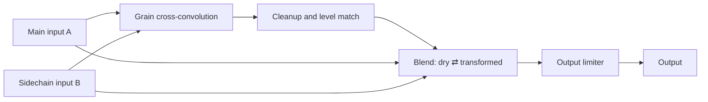

# Entangle

Combine the texture of two live sounds into something ethereal.

Entangle takes your main signal (**A**) and a second signal (**B**) — a vocal, a room mic, a synth, a
sidechain send — and cross-convolves them, so A plays back carrying B's spectral shape. A single blend
control walks from the dry input to the fully transformed sound, and a level stage keeps the result
sitting at the level the two sources actually have instead of drifting.

Ships as a **VST3** plug-in and a **standalone** app. C++23 on JUCE 9.

## How the signal flows



| Control | What it does |
|---|---|
| **Blend** | −1 keeps A's character, +1 takes B's, centre is the crossed pair |
| **Hop size** | how often the engine steps — smaller is finer and costs more CPU |
| **Grain length** | how long each slice of sound is remembered — longer smears further back |
| **Output gain** | −60 to +12 dB, under a safety ceiling |
| **Bypass** | crossfades the effect out without a click |
| **Normalisation amount** | how strongly the output is level-matched to the two inputs |
| **Silence floor** | below this level the level stage stands down, so quiet passages stay quiet |

The main bus is mono or stereo; the sidechain send is optional and can be wider than stereo, in which
case it is folded to mono before it drives the effect. The plug-in reports its latency to the host, so
the result stays sample-aligned with the dry inputs.

## Build

```bash
make install     # fetch the JUCE submodule and configure build/release
make build       # everything
```

| Want | Command | Output |
|---|---|---|
| VST3 bundle | `cmake --build build/release --target vstplug_VST3 -j4` | `build/release/src/Entangle/vstplug_artefacts/Release/VST3/` |
| Standalone app | `cmake --build build/release --target vstplug_Standalone -j4` | `…/vstplug_artefacts/Release/Standalone/` |
| Whole test suite | `ctest --test-dir build/release --output-on-failure` | — |
| One suite | `ctest --test-dir build/release -R "level normalizer" --output-on-failure` | — |

Two notes on a fresh clone:

* The two Helvetica Neue faces the interface ships with live in `public/helvetica-neue-5/` and are not
  tracked in git. Without them the configure step fails — put them there rather than switching the
  product to a system font.
* Configure warns that the plug-in code `entangle` is longer than four characters. Known packaging
  issue, not something to silence.

## Layout

```
src/        the plug-in shell and the libraries it is built from
tools/      offline renderers, test programs, CPU and memory measurement tools
docs/       decision log, host-behaviour matrix
juce/       the JUCE submodule
```

## Documentation

| If you want to… | Read |
|---|---|
| Work on the code | [`AGENTS.md`](AGENTS.md), then the `AGENTS.md` in the package you are in |
| Know why a number is what it is | [`docs/decisions.md`](docs/decisions.md) |
| Check how a real DAW behaves with it | [`docs/host-layout-matrix.md`](docs/host-layout-matrix.md) |
| Plan or pick up milestone work | `plan/` (kept out of version control until it stabilises) |

Every library is testable on its own from the command line — no DAW required. That is deliberate: the
audio code never includes a JUCE header, so its numbers can be checked as a plain program, and the
framework appears only at the plug-in boundary.
